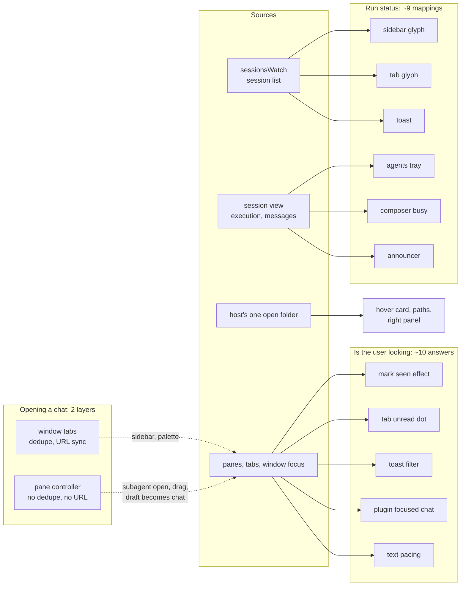
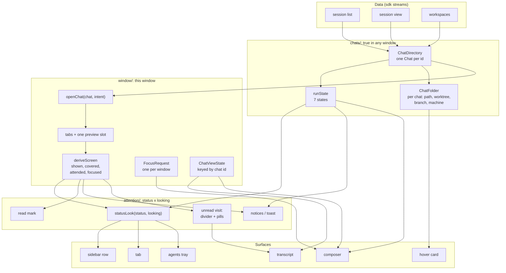
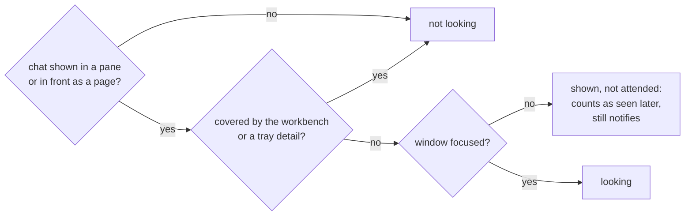
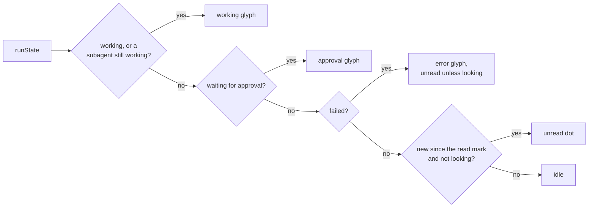
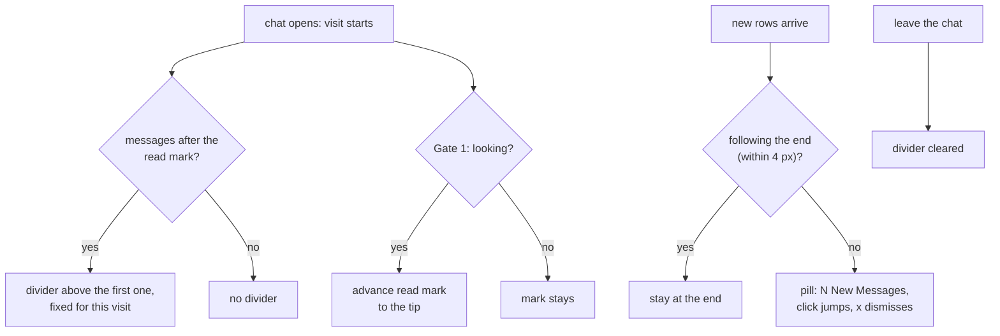
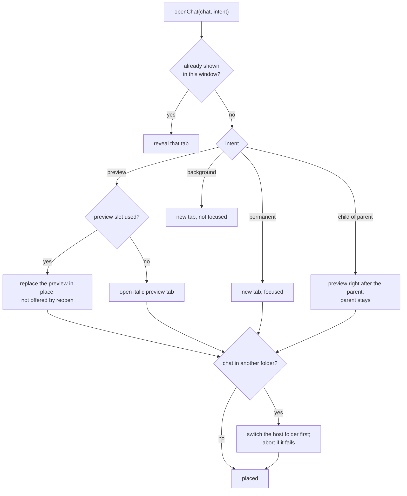
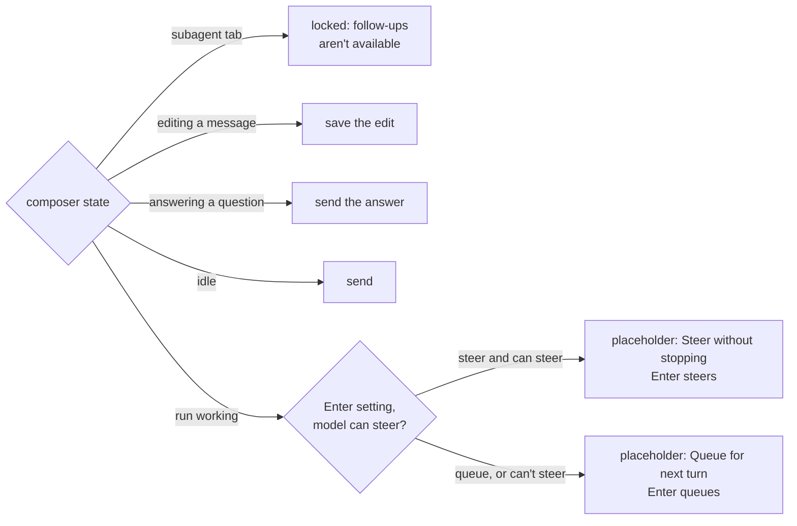
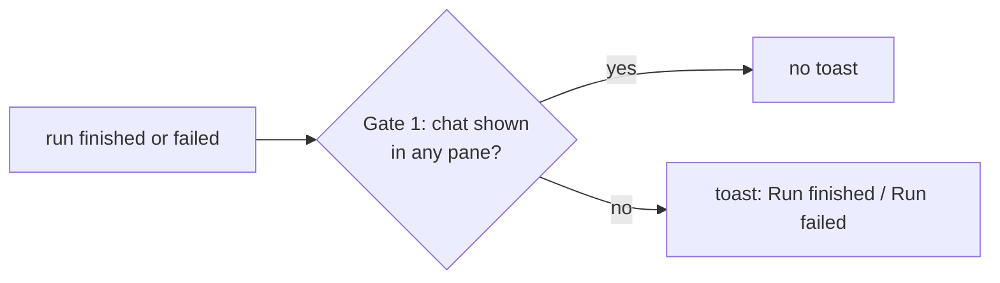

# Shell logic

How the chat shell decides what to show. The first graph is today, traced in [grounding.md](grounding.md). The rest are the target: one owner per concept, and the gates every surface goes through. The target follows the Opus candidate and is redrawn after synthesis with the other two candidates.

## Today: one fact, many deciders

The same question gets different answers depending on where it's asked: a stopped subagent reads as failed in one surface and done in another; the toast fires for the chat on screen; a chat's repo comes from the window, not the chat.

## Target: three owners, one direction

Imports go one way: surfaces → `attention/` → `window/` → `chats/` → data. Each concept folder is reachable only through its `index.ts`.

## Gate 1: is the user looking at this chat?

One function over state, never over what happens to be mounted. Every reader (read mark, unread dot, toast, pacing) asks this gate.

## Gate 2: what a row or tab shows

## Gate 3: the read mark and the "New" divider

## Gate 4: opening a chat

Every caller (sidebar click, palette, subagent link, "Open as full chat", drag, draft becoming a chat) goes through one entry with an intent.

A preview becomes permanent on double-click, Keep Open, drag, split, or a sent message.

## Gate 5: what Enter does in the composer

One function, `enterBehavior`, gives the placeholder, the send tooltip and the delivery.

## Gate 6: should a toast appear?

